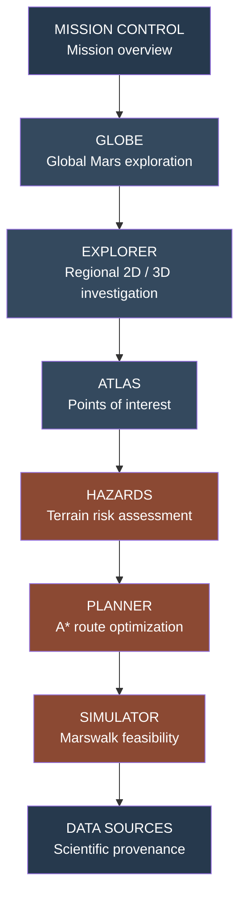
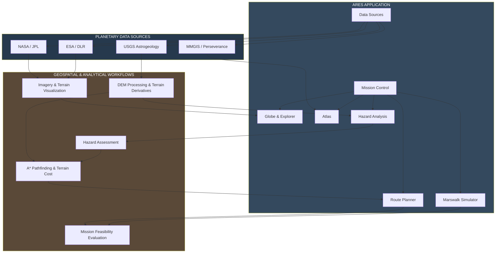
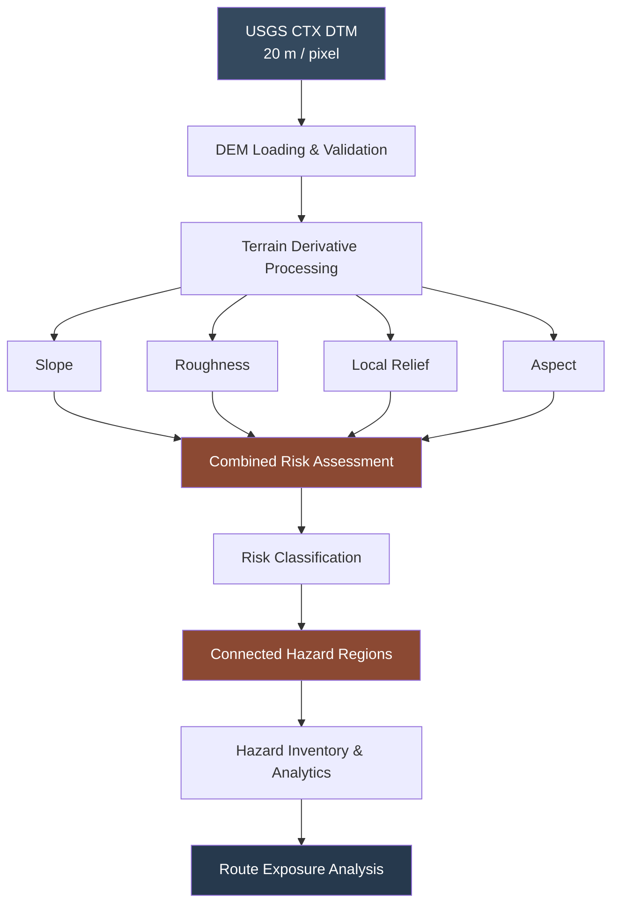
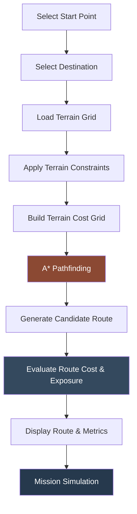
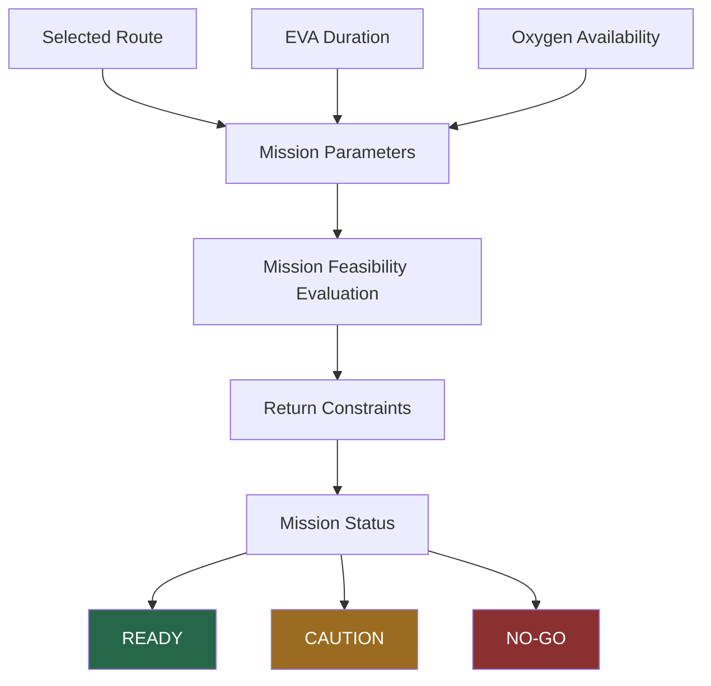

# ARES — Mars Mission Explorer

<p align="center">
  <strong>Explore Mars. Plan Smarter. Survive Further.</strong>
  <br />
  An integrated planetary exploration, terrain intelligence, and Marswalk mission-planning platform.
</p>

<p align="center">
  
  
  
  
</p>

<p align="center">
  <a href="https://ares-mars-explorer.vercel.app/">Live Application</a> ·
  <a href="https://ares-mars-explorer.vercel.app/data-sources">Data Sources</a> ·
  <a href="PROJECT_STATUS.md">Project Status</a> ·
  <a href="CHANGELOG.md">Changelog</a>
</p>

---

## 01 — Overview

**ARES (Mars Mission Explorer)** is an interactive planetary exploration and mission-planning platform developed for the **NASA Space Apps Challenge 2026**, under the challenge:

*Interplanetary Survival Guide: Martian Map.*

ARES transforms real planetary datasets into an integrated exploration and decision-support experience, with a primary focus on **Jezero Crater**, the region explored by NASA's Perseverance rover.

The platform connects planetary visualization, scientific terrain analysis, hazard identification, route optimization, and Marswalk mission simulation in one continuous workflow.

Rather than simply displaying the Martian surface, ARES helps users investigate terrain conditions, understand potential mobility challenges, explore possible traverses, and evaluate mission feasibility under defined assumptions.

### Project at a glance

| Attribute | Description |
|---|---|
| Project | ARES — Mars Mission Explorer |
| Challenge | Interplanetary Survival Guide: Martian Map |
| Competition | NASA Space Apps Challenge 2026 |
| Primary study area | Jezero Crater, Mars |
| Main terrain dataset | USGS Mars 2020 TRN CTX DTM Mosaic |
| DEM resolution | 20 m |
| Core purpose | Planetary exploration and Marswalk planning |
| Deployment | Vercel |
| License | Apache-2.0 |

<p align="center">
  <a href="https://ares-mars-explorer.vercel.app/">
    <strong>Explore the live ARES platform →</strong>
  </a>
</p>

---

## 02 — The Mission Workflow

ARES is designed around a connected exploration workflow: users move from understanding the planet to analyzing terrain, planning a traverse, and evaluating mission feasibility.



The modules form a coherent workflow rather than isolated visualizations.

### Core capabilities

| Module | Main capabilities | Status |
|---|---|---|
| Mission Control | Mission overview, planetary statistics, featured sites, data-source status | Live |
| Globe | Interactive 3D Mars globe, planetary markers, atmosphere, quality tiers | Live |
| Explorer | Jezero exploration in 2D/3D, imagery, elevation and terrain layers | Live |
| Atlas | Searchable, source-cited Martian points of interest | Live |
| Hazards | Terrain analysis, slope-derived difficulty, hazard regions and mobility profiles | Live |
| Planner | A* pathfinding, terrain-cost optimization, route comparison and profiles | Live |
| Simulator | Oxygen budget, EVA duration and return-feasibility indicators | Live |
| Data Sources | Dataset provenance, provider, instrument, resolution, coverage and credits | Live |

---

## 03 — Platform Architecture

ARES brings together planetary data, browser-based geospatial visualization, terrain analysis, and mission-planning logic.



### Architectural approach

ARES is primarily a frontend-driven application.

- Planetary imagery and elevation datasets provide the scientific foundation.
- Geospatial visualization enables interactive exploration of the Martian surface.
- Terrain-analysis workflows derive indicators from the Digital Elevation Model.
- The hazard engine evaluates terrain conditions using documented assumptions.
- The route planner uses A* pathfinding over a terrain-cost grid.
- The simulator evaluates Marswalk feasibility under configurable mission assumptions.

The application does not rely on a traditional dedicated application backend for its core terrain-analysis and route-planning workflows. These computations are performed client-side.

Vercel provides the production deployment and static asset delivery.

---

## 04 — Terrain Intelligence & Hazard Analysis

The Hazards module transforms elevation data into terrain indicators that help identify areas potentially challenging for rover mobility.

### Terrain analysis pipeline



### Terrain indicators

| Indicator | Purpose |
|---|---|
| Slope | Identifies steep terrain that may challenge mobility |
| Roughness | Measures local surface irregularity |
| Local relief | Describes elevation variation within the surrounding terrain |
| Aspect | Represents the orientation of terrain slopes |
| Combined risk | Integrates terrain indicators into an overall risk assessment |
| Hazard clusters | Groups connected moderate-or-higher risk cells into regions |

### Mobility profiles

ARES provides three configurable mobility profiles:

- **Conservative Rover** — stricter terrain tolerance assumptions.
- **Standard Explorer** — balanced mobility assumptions.
- **Capable Traverse** — more permissive terrain tolerance assumptions.

These profiles allow users to investigate how terrain assessments change under different mobility constraints.

The hazard inventory provides filtering, sorting, searching, and inspection capabilities for detected regions.

---

## 05 — Intelligent Route Planning

The Planner module calculates traverses across the Martian terrain using the **A* pathfinding algorithm**.

Instead of considering only geometric distance, the planner evaluates terrain-dependent movement costs.



### Planning capabilities

- Interactive start and destination selection.
- Terrain-aware A* pathfinding.
- Configurable maximum slope.
- Adjustable routing-grid resolution.
- Hazard-aware routing options.
- Estimated energy-cost evaluation.
- Route exposure analysis.
- Route visualization and supported export workflows.

The route-planning model uses a terrain-cost approach with a Pandolf-derived metabolic energy model adapted to Mars gravity and suit-related penalties.

The resulting routes are planning estimates, not certified traversability assessments.

---

## 06 — Marswalk Mission Simulator

A traversable route does not automatically mean a mission is feasible.

The Simulator extends the planning workflow by evaluating a Marswalk against configurable mission assumptions.

### Mission evaluation workflow



The simulator provides an educational decision-support workflow based on:

- Estimated EVA duration.
- Oxygen budget and availability.
- Route-related mission assumptions.
- Return feasibility and mission constraints.
- READY / CAUTION / NO-GO status indicators.

These indicators represent model-based estimates under the selected assumptions, not operational mission authorization.

---

## 07 — Scientific Data & Sources

Scientific data is central to ARES.

The platform combines planetary imagery, elevation models, exploration references, and planetary geographic information from recognized scientific providers.

### Main datasets

| Provider | Dataset / Instrument | Application |
|---|---|---|
| NASA / JPL | Mars Trek WMTS | Global and regional imagery |
| NASA / USGS | Mars planetary imagery and elevation products | Surface exploration |
| USGS Astrogeology | Mars 2020 TRN CTX DTM Mosaic | Jezero terrain analysis |
| NASA / GSFC | MOLA | Global elevation context |
| NASA / JPL / ASU | THEMIS | Planetary imagery |
| NASA / JPL / MSSS | CTX | Context imagery |
| NASA / JPL / University of Arizona | HiRISE | High-resolution imagery |
| ESA / DLR / FU Berlin | Mars Express HRSC | Regional planetary imagery |
| NASA / JPL MMGIS | Perseverance waypoint feed | Rover exploration references |
| NASA NSSDCA | Mars Fact Sheet | Planetary statistics |
| USGS | Gazetteer of Planetary Nomenclature | Geographic feature references |

### Key terrain dataset

**USGS Mars 2020 TRN CTX DTM Mosaic**

| Property | Value |
|---|---|
| Region | Jezero Crater |
| Dataset type | Digital Terrain Model |
| Resolution | 20 m |
| Primary use | Terrain analysis and route planning |

### Scientific traceability

ARES emphasizes transparent data interpretation:

- Coordinates carry an accuracy label: `verified`, `approximate`, or `illustrative`.
- Datasets identify their provider, instrument, and resolution.
- Scientific models document their assumptions.
- Terrain-analysis limitations are explicitly communicated.

For the complete registry, visit the application's [Data Sources page](https://ares-mars-explorer.vercel.app/data-sources).

---

## 08 — Technology Stack

ARES uses a modern web-based architecture for interactive planetary exploration and geospatial analysis.

| Category | Technology / Component |
|---|---|
| Frontend | React, TypeScript |
| Build system | Vite |
| Styling | Tailwind CSS |
| 2D geospatial visualization | Leaflet |
| 3D visualization | CesiumJS |
| Geospatial processing | GeoTIFF.js, Turf.js |
| Route optimization | A* pathfinding |
| Terrain analysis | Digital Elevation Model processing |
| Unit and component testing | Vitest |
| End-to-end testing | Playwright |
| Version control | Git, GitHub |
| Deployment | Vercel |

**Architecture note:** Core terrain processing, hazard analysis, and route computation run client-side. A traditional dedicated application backend is not required for these core workflows.

---

## 09 — Getting Started

### Prerequisites

- Node.js and npm.
- Git.
- A modern browser.
- Windows, Linux, or macOS development environment.

### Clone the repository

```bash
git clone https://github.com/amine-CS96/ARES-Mars-Explorer.git

cd ARES-Mars-Explorer
```

### Install dependencies

```bash
npm install
```

### Start the development server

```bash
npm run dev
```

Open the local development URL displayed by Vite, normally:

```text
http://localhost:5173
```

### Available commands

| Command | Description |
|---|---|
| `npm run dev` | Start development server |
| `npm run build` | Generate production build in `dist/` |
| `npm run preview` | Preview the production build |
| `npm run typecheck` | Run strict TypeScript checks |
| `npm run lint` | Run ESLint |
| `npm run test` | Execute Vitest tests |
| `npm run format` | Format project files with Prettier |

**Windows PowerShell note:** If PowerShell blocks `npm.ps1` because of its execution policy, invoke npm through `npm.cmd`:

```powershell
npm.cmd install
npm.cmd run dev
npm.cmd run build
npm.cmd run test
```

---

## 10 — Testing & Quality Assurance

ARES includes automated verification workflows to help maintain reliability across its modules.

| Tool | Purpose |
|---|---|
| TypeScript | Static type checking |
| ESLint | Code quality and linting |
| Vitest | Unit and component testing |
| Playwright | Browser-based end-to-end testing |
| Vite Build | Production build verification |

Run the main verification commands:

```bash
npm run typecheck
npm run lint
npm run test
npm run build
```

For the latest verified results, consult [`PROJECT_STATUS.md`](PROJECT_STATUS.md).

---

## 11 — Deployment

ARES is deployed on Vercel and connected to its GitHub repository.

**Production application:**

https://ares-mars-explorer.vercel.app/

### Deployment workflow


Push changes to the configured production branch to trigger the Vercel deployment workflow.

---

## 12 — Scientific Scope & Limitations

ARES is an independent educational exploration and mission-planning platform.

Its outputs must be interpreted within the limitations of the available planetary datasets and analytical models.

### Important limitations

- The primary Jezero terrain model has a resolution of 20 m per pixel.
- Individual rocks and other sub-20 m surface features are not resolved by this DEM.
- Hazard classifications depend on the selected mobility profile and documented model assumptions.
- Route costs and energy estimates are approximations.
- Mission simulation results depend on the configured assumptions and parameters.
- The platform does not replace detailed engineering analysis, rover navigation systems, or operational mission procedures.

**ARES is not an operational astronaut-safety system and must not be used as a substitute for certified mission-planning or life-support systems.**

---

## 13 — Project Documentation

ARES maintains a structured documentation system for developers, contributors, and future development sessions.

| File | Description |
|---|---|
| [`AGENTS.md`](AGENTS.md) | Project instructions, development conventions, architecture and AI-session guidance |
| [`PROJECT_STATUS.md`](PROJECT_STATUS.md) | Current project state and verification results |
| [`CHANGELOG.md`](CHANGELOG.md) | Chronological project history |
| [`docs/`](docs/) | Technical and scientific documentation |
| [`docs/DATA_SOURCES.md`](docs/DATA_SOURCES.md) | Dataset registry and provenance |
| [`docs/SCIENTIFIC_MODELS.md`](docs/SCIENTIFIC_MODELS.md) | Scientific models and assumptions |
| [`docs/ROUTE_PLANNING.md`](docs/ROUTE_PLANNING.md) | Route-planning methodology |
| Testing documentation | Verification strategy and test guidance |

---

## 14 — Credits & Acknowledgments

ARES builds upon planetary science datasets and exploration resources made available by the international planetary science community.

We acknowledge the contributions of:

- **NASA / JPL-Caltech**
- **NASA / USGS Astrogeology**
- **NASA / GSFC — MOLA**
- **NASA / JPL / ASU — THEMIS**
- **NASA / JPL / MSSS — CTX**
- **NASA / JPL / University of Arizona — HiRISE**
- **ESA / DLR / Freie Universität Berlin — Mars Express HRSC**
- **NASA GISS — Mars24**
- **NASA / JPL MMGIS — Perseverance waypoint references**

Additional references studied during development include:

- [NASA Mars Trek](https://trek.nasa.gov/mars/)
- [USGS Astrogeology](https://astrogeology.usgs.gov/)

**Design inspiration:** Sol Atlas ([GitHub](https://github.com/saracen66/the-sol-explorers)) — Apache-2.0. Inspiration only; no code copied.

---

## 15 — License & Disclaimer

This project is licensed under the **Apache License 2.0**. See [`LICENSE`](LICENSE) for the complete license text.

ARES is an independent educational project developed for the NASA Space Apps Challenge 2026.

It is **not affiliated with, endorsed by, or an official product of NASA, ESA, or USGS**.

Planetary datasets and third-party resources remain subject to their respective providers' terms and attribution requirements.

---

<p align="center">
  <strong>ARES — Mars Mission Explorer</strong>
  <br />
  <em>Explore Mars. Plan Smarter. Survive Further.</em>
  <br /><br />
  Built for the future of planetary exploration.
</p>
